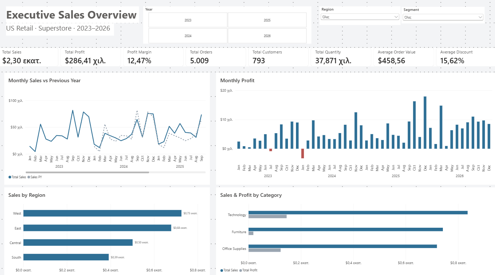
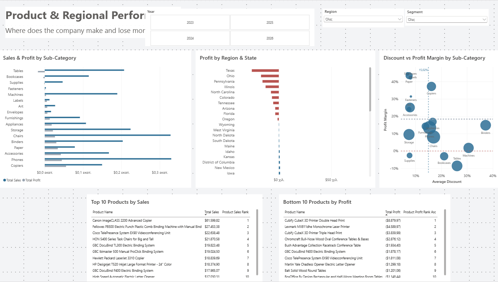
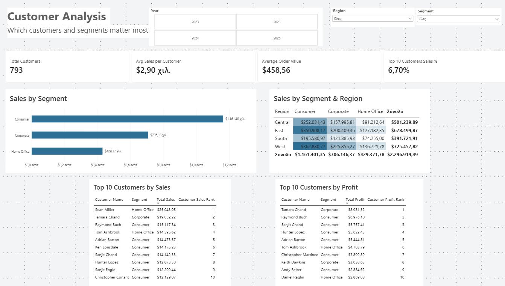

# Superstore Sales Performance Dashboard (Power BI)

A three-page Power BI report that analyses sales, profitability, products, regions and customers for a US retailer, built on the Tableau Sample Superstore dataset (2023–2026).

The goal was to go from raw order data to a clean star-schema model, a set of tested DAX measures, and a short list of findings that a manager could act on.



## Business questions

1. What is the overall commercial picture of the company?
2. Where does the company make and lose money (products and regions)?
3. How do discounts relate to profit?
4. Which customers and customer segments matter most?

## Dataset

Tableau Sample Superstore (newer version, order dates 2023–2026). It is a synthetic teaching dataset of a fictional retailer selling office supplies, furniture and technology. The source file has three sheets: Orders (10,194 rows, one row per product in an order), People (regional managers) and Returns.

After cleaning, the model contains 9,993 order lines, 5,009 orders, 793 customers and 1,894 products.

## Tools

Power BI Desktop, Power Query (M), DAX, Excel.

## Repository structure

```
01_raw/          original dataset, unchanged
02_working/      working copy used as the Power BI data source
03_powerbi/      Superstore_Sales_BI.pbix and the report theme (JSON)
04_screenshots/  exported report pages
05_report/       findings and recommendations (PDF and Word)
```

## Data preparation

Profiling was done in Power Query on the full dataset, with separate check queries so the main query stayed untouched. The main decisions:

- **Excluded 200 Canadian rows.** The business case concerns the US operation, and these rows had inconsistent customer IDs (for example one customer under five different IDs, and different IDs within the same order).
- **Removed one duplicate order line** that was identical to another apart from its row ID.
- **Built a composite product key** (Product ID + Product Name), because 32 Product IDs were shared by two different products.
- **Built a composite geography key** (Postal Code + City), because one postal code appeared under two cities.
- **Restored leading zeros** in postal codes (stored as 5-character text).
- Trimmed and cleaned text columns, checked logical rules (ship date not before order date, positive sales and quantities, discounts between 0 and 1) and set explicit data types, using fixed decimal for currency.

Queries are grouped into Staging, Model and QA Checks. Staging and check queries are not loaded into the model.

## Data model

Star schema with one fact table and four dimensions. All relationships are one-to-many with single-direction filtering.

```
                DimDate
                   |
DimCustomer — FactSales — DimProduct
                   |
             DimGeography
```

- **FactSales**: keys, Sales, Quantity, Discount, Profit, plus Order ID, Ship Mode and a Returned flag (merged from the Returns sheet).
- **DimCustomer**: Customer ID, name, segment.
- **DimProduct**: product key, ID, name, category, sub-category.
- **DimGeography**: geography key, postal code, city, state, region, regional manager (merged from the People sheet to avoid a snowflake).
- **DimDate**: calendar table created in DAX and marked as the date table. Auto date/time is turned off.

## DAX measures

24 measures in a dedicated measures table, grouped as KPIs, time intelligence, ranking and analysis. A few examples:

```DAX
Total Orders = DISTINCTCOUNT ( FactSales[Order ID] )

Average Order Value = DIVIDE ( [Total Sales], [Total Orders] )

Sales YoY % =
DIVIDE ( [Total Sales] - [Sales PY], [Sales PY] )

Customer Sales Rank =
RANKX (
    ALLSELECTED ( DimCustomer[Customer Name], DimCustomer[Segment] ),
    [Total Sales]
)

Loss-Making Products =
COUNTROWS ( FILTER ( VALUES ( DimProduct[Product Name] ), [Total Profit] < 0 ) )
```

Because each row of the source is one product within an order, orders and customers are counted with DISTINCTCOUNT, and ratios such as margin and average order value are calculated as ratios of totals. The headline figures were checked against the row counts from Power Query and against the commonly published Superstore totals. The only difference is the duplicate line removed during cleaning.

## Report pages

**1. Executive Overview.** Eight KPI cards, monthly sales against the previous year, monthly profit with loss months in red, sales by region, and sales and profit by category.

**2. Product & Regional Performance.** Sales and profit by sub-category, profit by state, a discount vs profit margin scatter by sub-category, and the top 10 and bottom 10 products.

**3. Customer Analysis.** Customer KPIs, sales by segment, a segment-by-region heatmap, and the top 10 customers by sales and by profit.

Year, Region and Segment slicers are synchronised across all pages. A hidden QA page holds the validation tables.





## Key findings

Headline figures for 2023–2026: $2.30M sales, $286.4K profit, 12.5% margin, 5,009 orders, 793 customers.

1. **Sales grew 51.5% in three years** ($484.0K in 2023 to $733.2K in 2026), with a dip only in 2024 and clear peaks in September and November–December.
2. **Deep discounts go together with low or negative margins.** Labels, Paper and Envelopes (average discount 7–8%) earn 42–44%, while Machines, Tables and Bookcases (21–31%) earn between 1.8% and −8.6%. Binders and Supplies are exceptions.
3. **Furniture sells well but barely makes money**: 32% of sales, 6% of profit, a 2.5% margin.
4. **Ten loss-making states, all with average discounts of 28–39%**, generate 31% of sales and lose $98.2K, an amount equal to 34% of total profit. Texas, Ohio, Pennsylvania and Illinois account for most of it.
5. **The customer base is broad.** The top 10 customers bring in only 6.7% of sales. Consumer is the largest segment, but Corporate customers spend the most per head.

## Recommendations

1. Set discount limits per sub-category for Tables, Bookcases and Machines, with approval above the limit.
2. Review pricing and costs for Tables, Bookcases and Supplies and for loss-making best-sellers.
3. Start a profitability plan in the four largest loss-making states, using the West region as the benchmark.

The full write-up is in [05_report](05_report/).

## Limitations

- Superstore is synthetic, so the findings illustrate the approach rather than a real business.
- The link between discounts and losses is an association, not proven cause and effect.
- There are no targets or cost data, so target achievement and cost drivers are not covered.

## How to open

Open `03_powerbi/Superstore_Sales_BI.pbix` in Power BI Desktop. To refresh the data, point the source to `02_working/sample_superstore.xlsx` via Transform data → Data source settings.

## Author

Panagiotis Gkritzalis, MSc candidate in Information Systems & Services, University of Piraeus

- LinkedIn: [linkedin.com/in/panagiotis-gkritzalis](https://www.linkedin.com/in/panagiotis-gkritzalis/)
- GitHub: [github.com/PanosGkritz](https://github.com/PanosGkritz)
